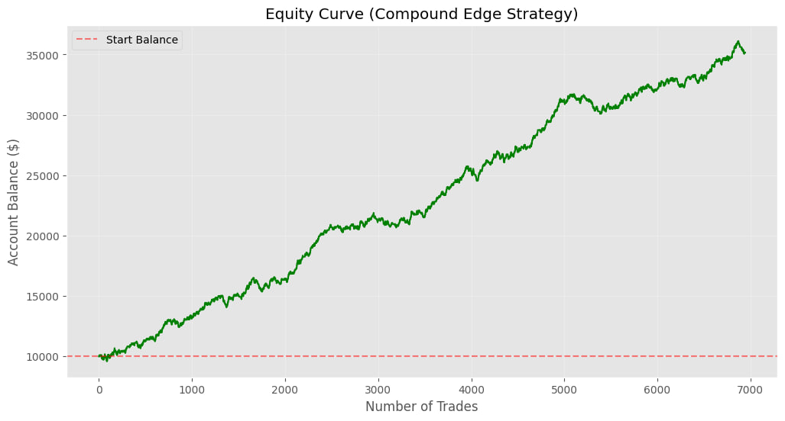
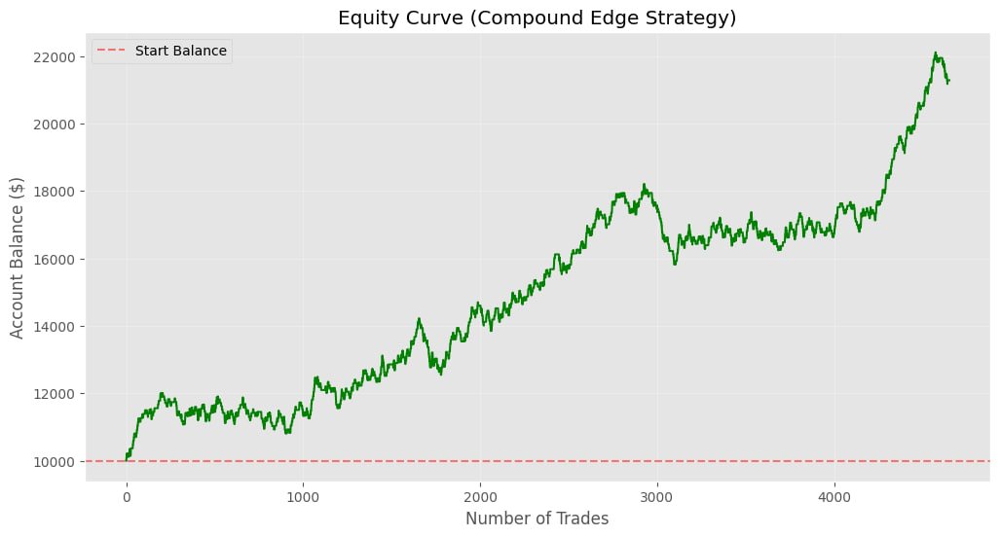
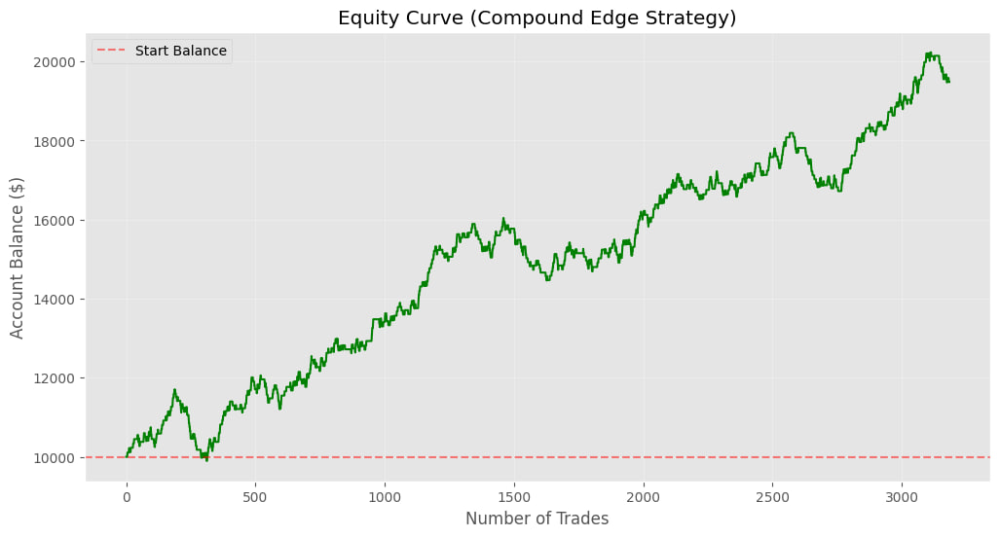
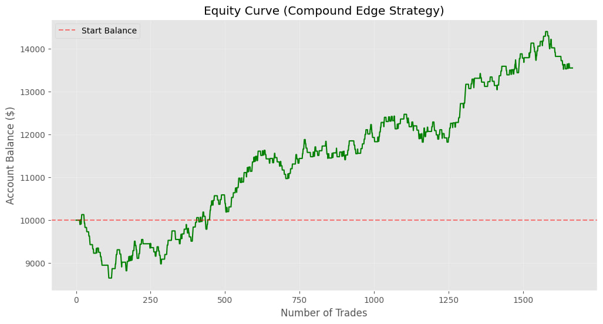
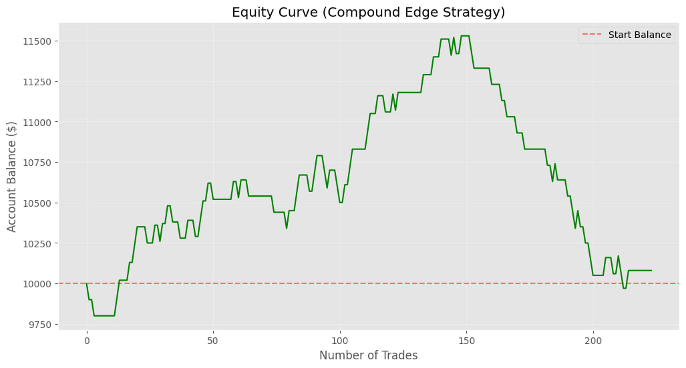
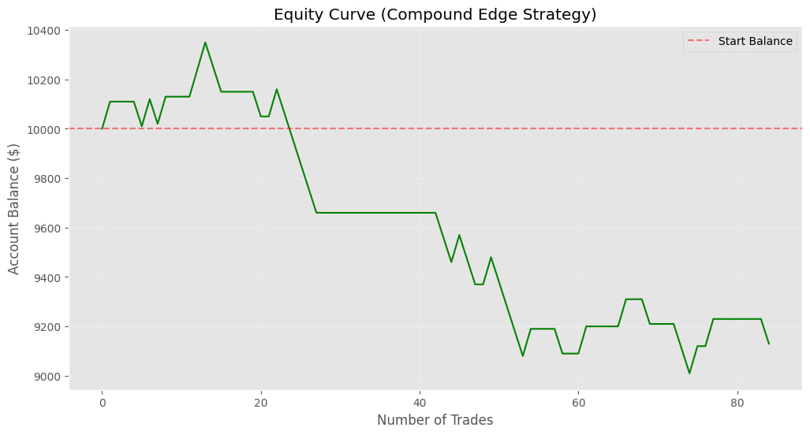
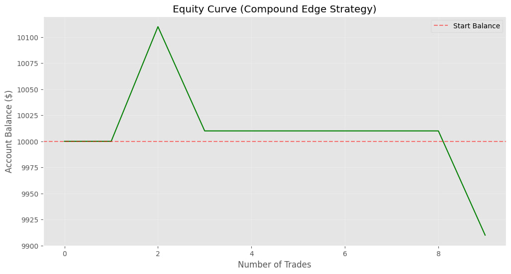

# 📊 Strategy Performance Analysis Report  
**Compound Edge Gold Strategy (1.1x Risk/Reward)**  

---

## 📌 **Overview**  
This report summarizes the backtest results of the Compound Edge Gold Strategy across multiple time windows. The strategy uses machine learning to filter high-probability short entries at market peaks and enforces a 1:1.1 risk/reward ratio.  

All tests start with **$10,000** and risk **$100 per trade**.  

---

## 📈 **Performance Summary**  

| Time Period        | Trades Taken | Wins | Losses | Win Rate | Net Profit | Final Balance |
|--------------------|--------------|------|--------|----------|------------|---------------|
| Full Dataset       | 1,714        | 936  | 778    | **54.61%** | +$25,160    | $35,160       |
| 2010-01-01 onwards | 1,206        | 628  | 578    | **52.07%** | +$11,280    | $21,280       |
| 2015-01-01 onwards | 804          | 428  | 376    | **53.23%** | +$9,480     | $19,480       |
| 2020-01-01 onwards | 395          | 205  | 190    | **51.90%** | +$3,550     | $13,550       |
| 2024-12-01 onwards | 79           | 38   | 41     | **48.10%** | +$80        | $10,080       |
| 2025-06-01 onwards | 36           | 13   | 23     | **36.11%** | –$870       | $9,130        |
| 2025-09-01 onwards | 3            | 1    | 2      | **33.33%** | –$90        | $9,910        |

---

## 📊 **Key Insights**  

### ✅ **Strengths**  
- **Positive expectancy** over longer timeframes (2010–2023).  
- **Win rate consistently above 50%** in most periods, supporting the 1.1x reward edge.  
- **Effective filtering**: AI + RSI filters rejected ~70–80% of signals, focusing only on high-quality setups.  

### ⚠️ **Recent Performance Decline**  
- **Win rate dropped below 50%** in 2024–2025.  
- **Market regime change** likely affected peak-detection logic.  
- **Reduced sample size** in recent months limits statistical significance.  

### 📉 **Drawdown & Risk**  
- Maximum drawdown occurs in recent windows (2025).  
- Strategy remains profitable overall but shows signs of degradation in the latest data.  

---

## 🖼️ **Charts**

### **Full Dataset (2004–2025)**
  

---

### **2010–2025**
  

---

### **2015–2025**
  

---

### **2020–2025**
  

---

### **2024–2025**
  

---

### **2025-06–01**
  

---

### **2025-09-01**
  

---

## 🔧 **Recommended Actions**  

1. **Review recent market structure** – Gold may have shifted from mean-reverting to trending behavior.  
2. **Re-tune ML model** with data from 2020 onwards to adapt to new regimes.  
3. **Add regime detection** – Incorporate volatility filters or trend indicators to avoid shorting strong uptrends.  
4. **Consider dynamic position sizing** – Reduce risk during low-confidence periods.  

---

## 📌 **Conclusion**  
The **Compound Edge Strategy** demonstrates robust historical performance with a mathematical edge from the 1.1x reward ratio. However, recent performance decay suggests the need for **adaptive logic** to maintain profitability in evolving market conditions.  

**Next steps**:  
- [ ] Regime-based model switching  
- [ ] Walk-forward optimization (rolling window)  
- [ ] Real-time forward testing on unseen 2025–2026 data  

---
